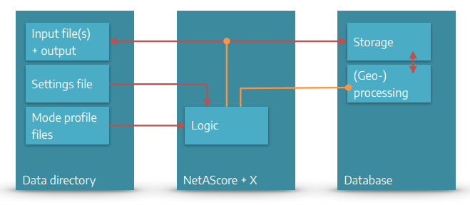
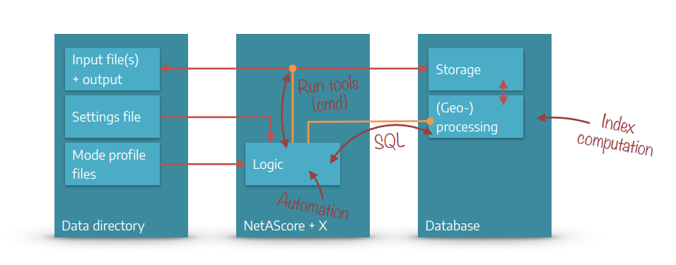

# How to contribute

We welcome contributions, feedback, and ideas that help develop NetAScore further. We also appreciate initiatives for integrating NetAScore and its output into other tools - please cite NetAScore as outlined on github. If you encounter any issues or bugs within the toolbox, feel free to open an issue on github and if you want to contribute to NetAScore development, please fork the repository and make a pull request after completing your edits.

If you want to work with the source code of NetAScore, you can start exploring it from the entrypoint of execution in `generate_index.py`. This script parses all arguments and settings and verifies their correctness and that all mandatory information is given. Then it runs all processing steps in order and calls the respective handlers for each step.

Below you find an overview over the general structure and main components of NetAScore. Detailed instructions on how to run NetAScore are available on the [respective wiki page](How-to-run-the-project).

## System Overview



### Interplay of Python and SQL

NetAScore can be categorized into 3 main components:

1. The NetAScore software: Scripts written in Python and SQL that automate the workflow and run (geo-) processing steps in the database. It relies on several command-line utilities to facilitate data import and export, as well as format conversion etc.
2. A PostgreSQL database that stores all data and performs (spatial) computations to generate the results.
3. The data directory that provides input data, mode profiles, and settings files to control the workflow. Results of the workflow are also added to this directory.

To ease the use of NetAScore, we provide a Docker-compose setup that contains NetAScore, a PostgreSQL database, as well as all required tools and packages. Detailed instructions for how to run NetAScore in Docker are provided on the [respective wiki page](How-to-run-the-project-in-a-Docker-environment)
<!--- TODO: add gfx of docker vs. stand-alone Python approach-->

## System Components and Workflow


NetAScore reads all settings, model parameters (mode profiles) and input files from the data directory. It then handles workflow automation with Python scripts that run external command line utilities where needed. As the main processing steps take place in a PostgreSQL database, the Python code also handles code execution in the database through SQL statements.
<!-- add slide 82 graphic -->
All steps of the workflow are controlled from the main Python file `generate_index.py`. It reads the settings file and accepts additional command-line parameters (e.g. to show more detailed debug output or to skip certain processing steps). Individual classes for each processing step take care of the respective tasks such as data handling and (geo-) processing in the database. With completion of the export step, the outputs are stored to a geopackage file inside the data directory. Since Version 2.0 the output file includes additional metadata tables that describe the settings, mode profiles, data sets used, and run metrics. 

### Data Directory

The `data` directory stores all external data NetAScore needs to access (settings file, mode profile files and all input datasets) as well as the output data sets generated by NetAScore.
Users can specify their tasks for NetAScore in settings files (e.g. `settings.yml`). The *mode profile* files are designed for editing, documenting, and sharing the definitions of model parameters for each transport mode.

#### Input file(s) + outputs

The input file(s) and the output are located within the `data` directory. Typical input files are network datasets (OSM PBF / XML File or GIP OGD export) and optionally a DEM (digital elevation model) or noise data (noise polygons).

The Output datasets are exported to PostgreSQL tables (`export_edge` with attributes, indicators, indices & `export_node` with elevation values) and as a GeoPackage file with the following layers: `edge` (with attributes, indicators & indices), `node` (with elevation values), and the metadata layers `meta_run`, `meta_steps`, `meta_datasets`, `meta_profiles` and `meta_areas` (see [The Workflow](The-workflow)). Default QGIS layer styles are included in the GeoPackage since NetAScore version 2.0.

#### Settings file

Settings files are written in YAML `.yml` and placed inside the data directory - e.g. `data/settings.yml`. For each run of NetAScore, the settings file to use is specified as command line parameter - e.g. `docker compose run netascore data/settings.yml`.

The settings file contains information such as:

... DB connection parameters

```yaml
database:
  host: localhost
  port: 5432
  dbname: netascore

```

... references to the input file and optional datasets

```yaml
import:
  type: osm
  filename: austria-latest.osm.pbf
  bbox: [47.7957, 13.0117, 47.8410, 13.0748]
optional:
  dem:
    filename: austria.tif # GeoTIFF
    srid: 31287
  noise:
    filename: noise.gpkg # GeoPackage

```

... references to mode profiles

```yaml
profiles:
  -
    profile_name: bike
    filename: profile_bike.yml
  -
    profile_name: walk
    filename: profile_walk.yml

```

... export settings

```yaml
export:
  type: geopackage
  filename: netascore_output.gpkg

```

You find more information on the settings file at [configuration of the settings](Configuration-of-the-settings).

#### Mode profile files

Mode profiles are used to define the core model logic: Here, weights are assigned per indicator, and individual indicator values are mapped to numerical values that represent the respective suitability. It is also possible to define custom value overrides, to capture certain indicator value combinations.

You find all information on the [mode profiles](Mode-profiles) page.

## NetAScore Source Code File Structure

This section gives an overview of the source code structure of NetAScore. If you only want to use the software and adjust model parameters, you do not need to dive into this. However, if you are interested in supporting NetAScore code development, we want to give you some hints on how the software is structured.
<!--- add images -> CW: suggest to use slide 79 for now to give an overview -->

The Main class and recommended starting point for working with the source code is the file `generate_index.py`. It contains the main sequential logic of NetAScore, reads the parameters and settings provided and triggers the individual processing steps.

The `sql` folder contains two subdirectories: `functions` and `templates`. Here the core logic of (geo-) processing within the PostgreSQL database is contained. Generic SQL-functions as well as `JinjaSQL` templates are used for automating the workflow with Postgres.

The folder `toolbox` contains generic helper classes. Currently those are a database helper (PostgresConnection) `dbhelper.py` and a class for logging and general tasks `helper.py`.

Within `core`, classes that handle the main processing steps of NetAScore are contained ([more information on the workflow](The-workflow)). The class `DbStep` in `db_step.py` defines the general interface for processing steps. Further modules in `core`:

- `dataset_registry.py`: registry of the datasets in the shared data schema (source file, import settings, coordinate system, covered area) - decides whether existing data can be reused (setting `on_existing`)
- `metadata.py`: metadata of a run (stored in the case schema and exported to the GeoPackage as `meta_*` layers)

The file `settings.py` contains global settings (e.g. the NetAScore version, Overpass API endpoints) and the list of known keys of the settings file, which is used to report unknown keys.

The folder `resources` contains the osm2pgsql flex configuration `osm2pgsql_flex.lua` for the OSM import and the default layer styles (`styles`) that are added to the output GeoPackage.

## Code state and releases

NetAScore records the code state it runs with (Git branch and commit, with the suffix `-dirty` for uncommitted changes) in the console output and in the metadata (`netascore_commit` in `meta_run` and `meta_steps`). Docker images have no Git history: here, the code state is taken from the build argument `NETASCORE_COMMIT`.

The script `scripts/build_docker_image.py` builds the Docker image and sets this build argument. It runs on macOS, Linux and Windows (requires Python 3.9+, Git and Docker):

```bash
# local build for the platform of this machine -> netascore:<version> and netascore:latest
python scripts/build_docker_image.py

# release build for linux/amd64 and linux/arm64, pushed to Docker Hub (requires 'docker login' and Docker Buildx;
# only for a committed state with the release tag v<version>)
python scripts/build_docker_image.py --push [--latest]
```

Further options: `--image` (image name), `--platforms`, `--dry-run` (only show the Docker commands), `--allow-dirty` and `--allow-untagged` (not recommended for releases).

The GitHub workflows of the repository test the Docker image (`docker-test.yml`) and publish releases (`release.yml`). The release workflow can also publish the Docker image of a new release to Docker Hub (enabled with the repository variable `DOCKER_PUBLISH`).

## PostgresConnection class (db helper)

The PostgresConnection class is located at `/toolbox/dbhelper.py` and abstracts several commonly used functionalities regarding interaction with the Postgres database and PostGIS extension. It handles automatically (re-) establishing database connections and provides Python functions for common tasks such as setting the working schema, querying data, checking whether a table exists, handling name conflicts and parsing / executing JinjaSQL templates.
