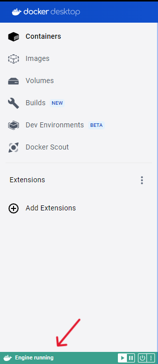
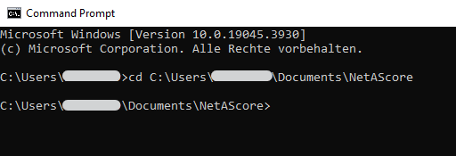
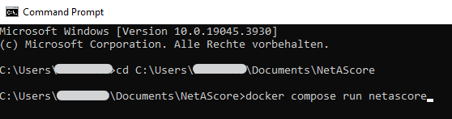
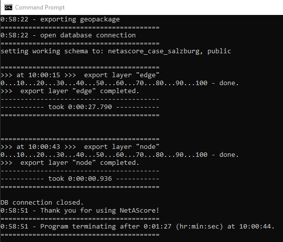
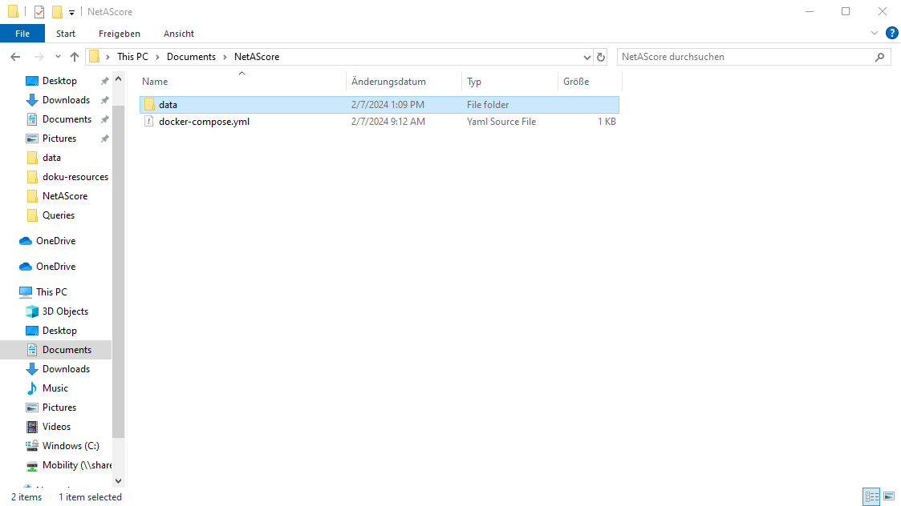
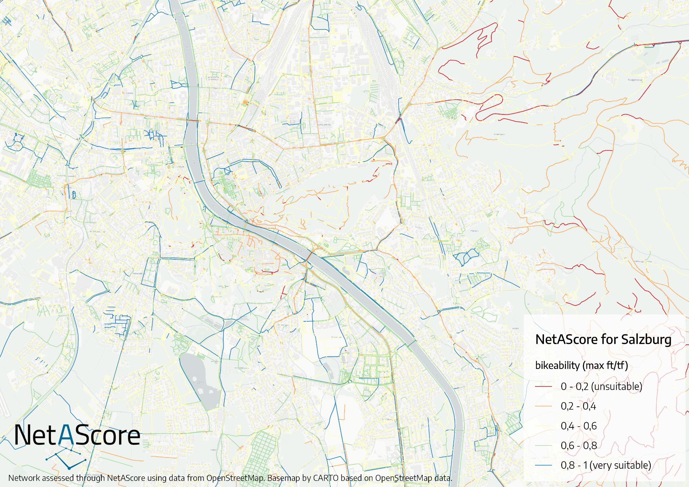
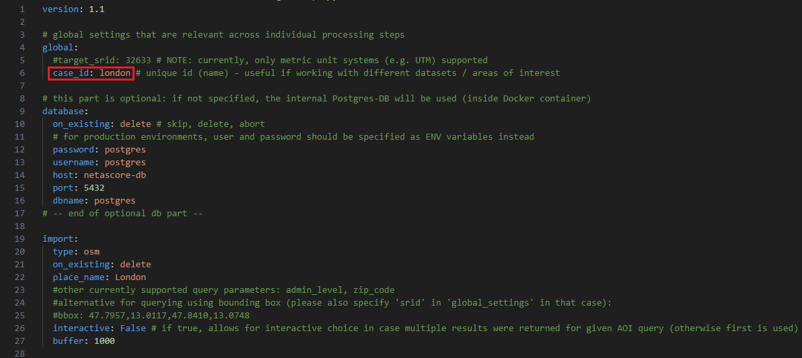
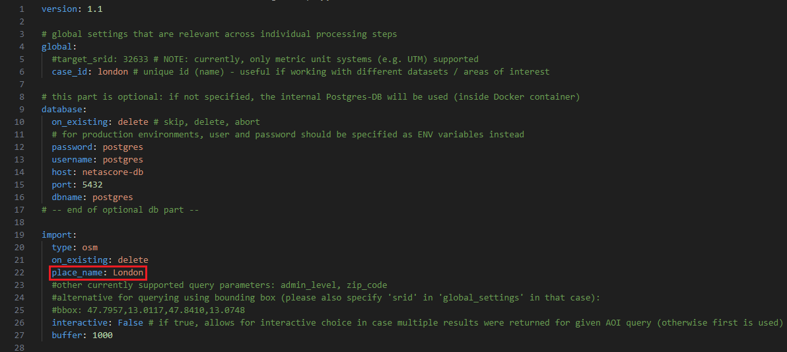

# Quickstart-Guide

## How to get started?

To get a better impression of what this toolset and workflow provides, you can quickly start with processing a sample area, by default covering the city of Salzburg in Austria.
In this guide you will learn how to run NetAScore for a sample area, how to adjust the settings to [run it for your own area of interest](#run-netascore-for-your-own-area-of-interest) and how to [add more detail](#add-more-detail) by using additional datasets (e.g. an elevation model (DEM) to derive slope).

*If you run into any bugs when working with NetAScore, please feel free to create an issue on github, outlining the problem you encountered. We are very happy to receive feedback which helps us to further improve NetAScore.*

### Easy quickstart: ready-made Docker image

The easiest way to get started is running the ready-made Docker image. All you need for this to succeed is a [Docker installation](https://docs.docker.com/engine/install/), running Docker Desktop (or Docker Engine on Linux) and internet connection. In order to run the NetAScore example, follow these steps:

- Install [Docker](https://docs.docker.com/engine/install/) and follow the instructions presented after you selected your operating System. Then, make sure Docker is running - when using Docker Desktop, the bar on the bottom left of the docker-desktop window should be green, like this:

- download the [`docker-compose.yml`](https://github.com/plus-mobilitylab/netascore/blob/main/examples/docker-compose.yml) file from the `examples` directory (use the button "Download raw file" on the GitHub page) and save it to an empty directory on your machine. In this Tutorial the directory is called `NetAScore`

- in order to proceed, please open your terminal. On Windows, search for `cmd` in your search bar. For Mac, search `terminal`). Open your system's terminal app and navigate to your previously created empty directory. This can be done by either manually typing `cd ` followed by the directory`s file path or by dragging and dropping the folder into the command line app, similar to the example below:

 You can tell that you are now in the correct directory if the filepath stated matches your newly created directory.

- from within this directory in your terminal, execute the command stated below. Docker will start downloading the NetAScore image and all required dependencies, setup the environment and execute the workflow for the exemplary case of Salzburg, Austria:
  `docker compose run netascore`

- running the docker image might take a while, as NetAScore first loads an area of interest by place name, then downloads the respective OpenStreetMap data and afterwards imports, processes and exports the final dataset. You can tell the run was completed successfully once the Database connection is closed, which looks like this:

- A new subdirectory named `data` will be present after successful execution. Within this folder, the assessed network is stored in `netascore_salzburg.gpkg`. It includes a layer `edge` with *bikeability* in columns `index_bike_ft` and `index_bike_tf` and *walkability* in `index_walk_ft` and `index_walk_tf`. The extensions `ft` and `tf` refer to the mapping direction of an edge: *from-to* or *to-from* node. Index values represent the assessed suitability of a segment for cycling (*bikeability*) and walking (*walkability*).

#### What the results look like:

Currently, NetAScore does not come with a built-in visualization module. However, since NetAScore version 2.0, the result data set has default layer styles added. You can easily visualize the *bikeability* and *walkability* index by loading the resulting geopackage in [QGIS](https://qgis.org). Simply drag and drop the geopackage into a new QGIS project and select the `edge` layer. The GeoPackage contains layer styles for each computed index. By default, the first index available is visualized. Styles use the higher value of both directions along each edge. To switch to another mode profile, right-click the `edge` layer and select its style (e.g. *Styles* > *index_walk*). You can also define your own symbology that visualizes one of the computed index values. An index value of `0` refers to unsuitable infrastructure, whereas `1` represents well suited infrastructure.

Since version 2.0 the GeoPackage also contains metadata layers (`meta_run`, `meta_steps`, `meta_datasets`, `meta_profiles`, `meta_areas`) that document the settings, input data and mode profiles used to generate the result.

This is an exemplary visualization of *bikeability* for Salzburg, Austria:

## Run NetAScore for your own area of interest

The easiest way to run a network assessment for your own area of interest is by adapting the given example in `examples/settings_osm_query.yml`:

- create a new **subdirectory** named **`data`** (if you already ran the quickstart example, you can just use the `data` directory created)
- download the **settings template** to your `data` directory from `examples/settings_osm_query.yml` [file link](https://github.com/plus-mobilitylab/netascore/blob/main/examples/settings_osm_query.yml).
- add the **mode profiles** for *bikeability* and *walkability* to the `data` directory: download both, `profile_bike.yml` and `profile_walk.yml` from the `examples` folder.
- **edit** your newly created **settings file** `settings_osm_query.yml` - e.g. to download data for the City of London:
  - provide a **`case_id`**  in `global` section (only alphanumeric characters are allowed; this will be added e.g. to the output file name) - e.g. `case_id: london`

  - specify a **`place_name`** in the section `import`: This name is used to query data from OpenStreetMap: e.g. `place_name: City of London`

- **run NetAScore** by executing the following line from a terminal inside the main NetAScore directory (parent of `data`):

  `docker compose run netascore data/settings_osm_query.yml`

  (Here, the last argument refers to the settings file to use for this run of NetAScore.)

*NetAScore allows you to automatically download OpenStreetMap data via Overpass API for areas up to 1500 km². For larger areas, or if you want to use a local OSM extract, you can do so using the 'filename' property (see `settings_osm_file.yml`). If you keep the 'place_name', the local OSM file is clipped to this area. The place name is resolved using OSM Nominatim. If several areas match, set `interactive: True` - you will then be prompted for which search result you would like to use.*

***Please note: By default, the network is clipped to the bounding box (rectangle) containing the polygon returned for the place name query, extended by `buffer`. Set `clip: aoi` to clip it to the polygon itself. By default, an appropriate coordinate reference system (CRS) is determined based on the centroid of the area you requested (UTM zone). You may also set a specific CRS (metric only) by providing the global option target_srid.***

For further information on import options for OSM see the [settings documentation](Configuration-of-the-settings).

## Add more detail

The example settings use OpenStreetMap data as the only input for NetAScore. While this gives a good first estimate of *bikeability* and *walkability*, utilizing additional input datasets can further improve the results. NetAScore supports additional datasets such as a *DEM* (digital elevation model) and *noise* data (traffic noise polygons). If you want to add a DEM as an additional dataset, we recommend using a DEM (terrain model) with at least 10 m spatial resolution (or finer), for sufficient level of detail. Please refer to the [settings documentation](Configuration-of-the-settings) for details.

To add optional input data sets, see the exemplary workflow below:

### Example: adding a DEM as an additional dataset:

- acquire the file(s) for your area of interest - availability of DEM, noise map, etc. may largely vary depending on the region. In our example case we add the [DEM of Great Britain](https://environment.data.gov.uk/dataset/ce8fe7e7-bed0-4889-8825-19b042e128d2) in order to compute slope as additional indicator for our London example.

- add the downloaded file(s) to the `data` subdirectory (where the settings file and mode profiles are located)

- edit the settings file (located within the same `data` directory) to add the new datasets to the workflow. In our example case we want to add elevation data (DEM) and need to specify the projection of the input file. Thus, we have to change the `dem` subsection of `optional` (see [`settings_osm_file.yml`](https://github.com/plus-mobilitylab/netascore/blob/main/examples/settings_osm_file.yml) as template):

  - `filename` has to be changed to the name of the local DEM-file we want to use

  - `srid` has to be changed from the default to the EPSG-code of the DEM. For our London example it has to be 27700, as the DEM uses the British National Grid projection (EPSG code 27700).

- execute NetAScore again from the parent directory:
  `docker compose run netascore data/<your_settings_file>.yml`
  (where `<your_settings_file>` refers to the file name you chose for the edited settings file)

Using the same workflow, other additional data sets can be added. For more options see the [settings-documentation](Configuration-of-the-settings).

*For additional information on working with docker and NetAScore, please refer to the [docker-guide](How-to-run-the-project-in-a-Docker-environment).*
